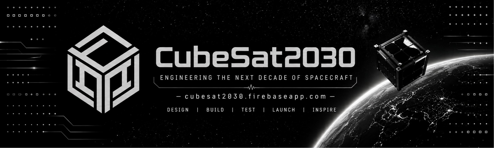

## About Us

CubeSat2030 is an aerospace engineering initiative driven by the ambition to design, develop, build and launch a CubeSat into Earth orbit.

Our goal is to turn an ambitious engineering vision into reality through research, experimentation, technological development and practical engineering.

What starts as an individual initiative is intended to grow into a collaborative engineering organization, bringing together people who share an interest in aerospace, robotics, electronics, software development and space exploration.

## Our Mission

To develop the knowledge, technologies and engineering capabilities required to design, build, test and ultimately launch a CubeSat into orbit.

## What We Do

Our work spans multiple engineering and technological disciplines:

- Additive Manufacturing (3D Printing)
- Aerospace and Space Systems Engineering R&D
- Embedded Systems and Firmware Development
- Electronics and Hardware Engineering
- Software Engineering and Development
- Robotics and Autonomous Systems
- Research, Development and Experimentation
- Systems Integration, Testing and Validation

## Our Vision

To build a, collaborative aerospace engineering initiative that contributes to the development of accessible space technologies while inspiring practical engineering, innovation and exploration.

**Official Website:** [cubesat2030.firebaseapp.com](https://cubesat2030.firebaseapp.com)
